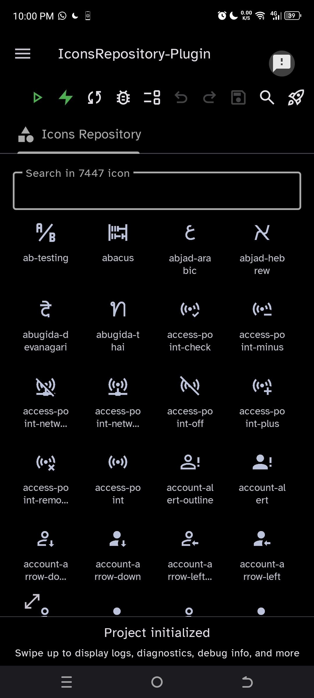
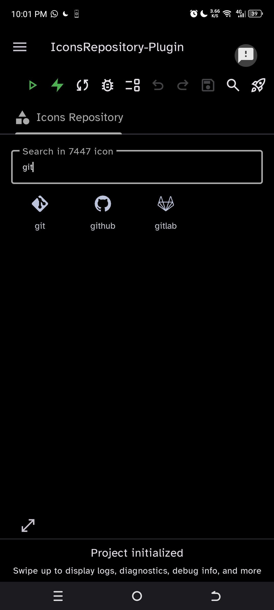
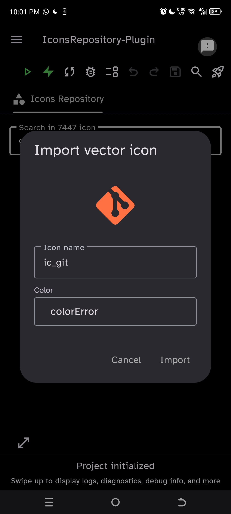
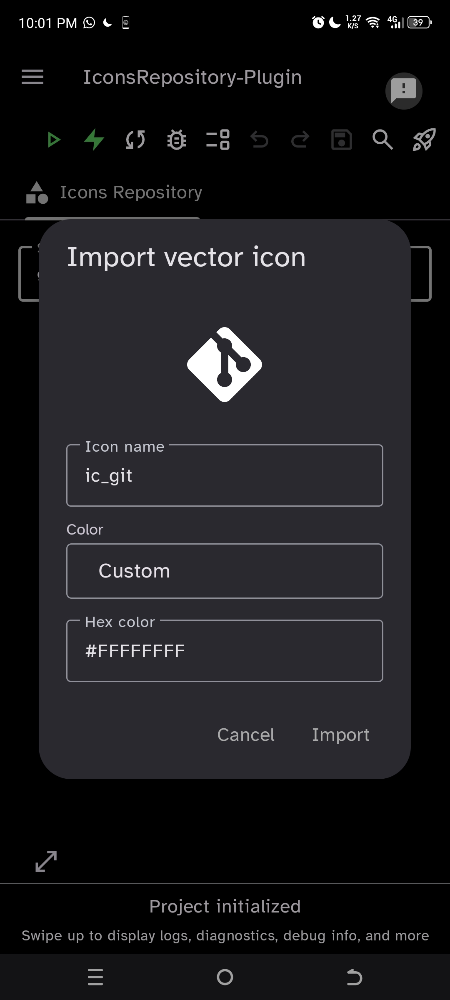

  

  # IconsRepository Plugin

  

    <b>A powerful icon management plugin for CodeOnTheGo IDE on Android</b>
  

  

    
    
    
  

---

## 📌 Overview

**IconsRepository Plugin** seamlessly integrates into the **CodeOnTheGo IDE** sidebar, allowing Android developers to quickly search, customize, and import Material Vector Drawables and SVG icons directly into their projects without leaving the IDE.

---

## ✨ Features

- 🔍 **Instant Search:** High-performance search index (Trie / Fast Index) to quickly filter through thousands of Material icons.
- 🎨 **Color & Size Customization:** Preview and tweak icon tint colors (hex code or dynamic colors) and dimensions before importing.
- ⚡ **Direct Import:** Automatically converts SVG/Material icons into Android Vector Drawables (`.xml`) and saves them straight into your project's `res/drawable/` directory.
- 🌙 **Theme Adaptive:** Full support for both Light and Dark modes in CodeOnTheGo IDE.
- 🧩 **Sidebar Integration:** Access your icon repository with one tap from the IDE sidebar.

---

## 📸 Screenshots

  <table>
    <tr>
      <td align="center" width="25%">
        
         <b>Browse & Search</b>
      </td>
      <td align="center" width="25%">
        
         <b>Customize</b>
      </td>
      <td align="center" width="25%">
        
         <b>Import to Project</b>
      </td>
      <td align="center" width="25%">
        
         <b>Settings & Theme</b>
      </td>
    </tr>
  </table>

---

## 📋 Requirements

| Requirement | Supported Version |
| :--- | :--- |
| **IDE** | CodeOnTheGo IDE |
| **Min IDE Version** | `v26.42` or higher |
| **Android Target SDK** | `26`+ |

---

## 🚀 Installation

1. Download the latest `.cgp` plugin package from [Releases](https://github.com/omar-haidar/IconsRepository-Plugin/releases/latest).
2. Open **CodeOnTheGo IDE**.
3. Navigate to **Settings** ➔ **Plugin Manager**.
4. Select **Install Plugin** and pick the downloaded `IconsRepository.cgp` file.
5. Restart CodeOnTheGo IDE to activate the plugin sidebar icon.

---

## 🛠️ Usage

1. **Open Sidebar:** Tap the **Icons Repository** icon on the CodeOnTheGo sidebar.
2. **Search:** Type the icon name (e.g., `search`, `home`, `settings`) in the search bar.
3. **Select & Customize:** Tap an icon to open the customization dialog. Adjust size, tint color, or vector settings.
4. **Import:** Tap **Import** to add the generated `.xml` vector drawable directly into your project's `res/drawable` folder.

---

## ⚠️ Known Issues & Constraints

- Not compatible with CodeOnTheGo IDE versions prior to `v26.42`.

---

## 🤝 Support & Feedback

- 🐛 **Report Bugs:** [GitHub Issues](https://github.com/omar-haidar/IconsRepository-Plugin/issues)
- 💬 **Community & Support:** [Telegram Channel](https://t.me/OMAR_HAIDAR_0)
- 👨‍💻 **Developer:** [Omar Haidar](https://github.com/omar-haidar)

---

  Made with ❤️ for the CodeOnTheGo Developer Community

